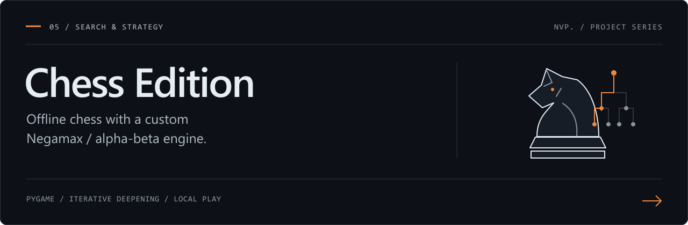
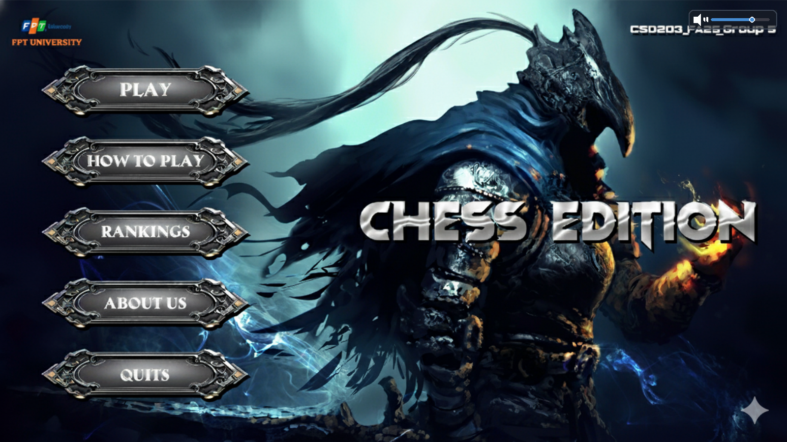
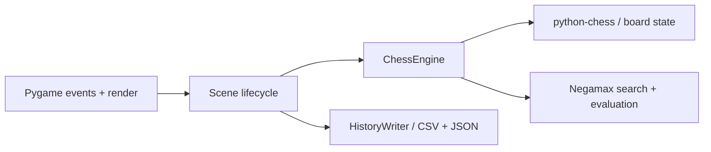

<div align="center">

# Chess Edition

### Desktop chess, driven by a custom search engine.

Game cờ vua offline với giao diện Pygame, chế độ PvP/PvAI và AI tìm kiếm bằng Negamax.

   

[Thiết kế kỹ thuật](#thiết-kế-kỹ-thuật) · [AI engine](#ai-engine) · [Chạy dự án](#chạy-dự-án) · [Bản Windows](#bản-windows)

</div>



<p align="center"><sub>Giao diện menu thực tế, render từ mã nguồn. Tài nguyên hình ảnh và nhận diện nhóm được giữ từ dự án gốc.</sub></p>

## Tổng quan

Chess Edition kết hợp một ứng dụng cờ vua có thể chơi được với một engine tìm kiếm có thể đọc và mở rộng. `python-chess` quản lý trạng thái bàn cờ và nước đi hợp lệ; phần AI bổ sung chiến lược tìm kiếm, đánh giá thế cờ và điều chỉnh độ khó. Pygame đảm nhiệm tương tác, hiển thị và âm thanh.

| Trải nghiệm | Khả năng hiện có |
| --- | --- |
| Chơi cờ | Hai người trên cùng máy hoặc đấu AI; chuỗi trận best-of-N. |
| Hỗ trợ người chơi | Gợi ý nước đi, hoàn tác, đồng hồ, tạm dừng, đầu hàng và xem lại nước đi. |
| Cá nhân hóa | Theme, hai bộ quân cờ, avatar, nhạc nền và cửa sổ thay đổi kích thước. |
| Lưu trữ cục bộ | Tài khoản, lịch sử nước đi CSV, kết quả trận JSON và cài đặt. |

## Thiết kế kỹ thuật



| Quyết định triển khai | Ý nghĩa |
| --- | --- |
| Scene có `handle_event`, `update`, `render` | Tách vòng lặp ứng dụng khỏi từng màn hình menu, thiết lập và ván đấu. |
| Engine độc lập với giao diện | Có thể kiểm tra nước đi, FEN và kết quả tìm kiếm mà không khởi chạy cửa sổ. |
| Worker AI dùng snapshot bàn cờ và request ID | Tính nước đi ngoài vòng render, gắn kết quả với yêu cầu và thế cờ đã khởi tạo nó. |
| Tìm kiếm tăng dần độ sâu | Có nước đi ứng viên từ các lượt tìm kiếm trước khi ngân sách suy nghĩ hết. |
| Lịch sử nước đi dùng hàng đợi và worker | Giảm công việc ghi CSV trực tiếp trong luồng tương tác. |
| Asset/font cache và telemetry | Tái sử dụng tài nguyên; quan sát thời gian render và thời gian AI trong quá trình phát triển. |

Đọc triển khai: [engine](core/chess_engine.py), [hàm đánh giá](core/ai_difficulty.py), [vòng lặp ứng dụng](main.py), [lưu lịch sử](core/history.py).

## AI engine

Engine dùng **Negamax + alpha-beta pruning**, kết hợp các thành phần:

- **Iterative deepening:** tăng dần độ sâu trong ngân sách thời gian.
- **Move ordering:** ưu tiên nước bắt quân, chiếu, killer moves và history heuristic.
- **Transposition table:** lưu điểm, độ sâu, loại bound và nước đi theo khóa FEN; giới hạn 100.000 entry.
- **Quiescence search:** mở rộng bước đánh giá ở nhánh chiến thuật khi tùy chọn này được bật.
- **Đánh giá thế cờ:** vật chất, vị trí quân, độ cơ động, an toàn vua, cấu trúc tốt, kiểm soát trung tâm và phối hợp quân.

Các giá trị sau lấy từ `AI_DIFFICULTY_CONFIGS` trong [core/ai_difficulty.py](core/ai_difficulty.py):

| Mức độ | Độ sâu mục tiêu | Ngân sách mỗi lượt tìm kiếm | Xác suất chọn ngẫu nhiên trong nhóm nước tốt |
| --- | ---: | ---: | ---: |
| Easy | 6 | 2.000 ms | 10% |
| Medium | 8 | 4.000 ms | 0% |
| Hard | 12 | 8.000 ms | 0% |

Độ sâu đạt được phụ thuộc thế cờ, máy chạy và điều kiện dừng. Các cấu hình này chưa được hiệu chuẩn thành mức Elo; ngân sách được kiểm tra trong thuật toán, chưa phải deadline cứng cho toàn bộ lượt xử lý.

## Chạy dự án

**Môi trường:** Python 3.11 trở lên, Pygame và `python-chess`. Pillow hỗ trợ xử lý ảnh/icon. Phiên bản phụ thuộc trực tiếp được ghi trong [requirements.txt](requirements.txt).

### Windows PowerShell

```powershell
git clone https://github.com/VPhunggggg/chess-edition-ai.git
cd chess-edition-ai
py -3.11 -m venv .venv
.\.venv\Scripts\python.exe -m pip install -r requirements.txt
.\.venv\Scripts\python.exe main.py
```

### Linux / macOS

```bash
python3 -m venv .venv
source .venv/bin/activate
python -m pip install -r requirements.txt
python main.py
```

Chạy từ thư mục gốc của repo để các đường dẫn `assets/` và `data/` được phân giải đúng. Một số hộp thoại sử dụng Tkinter; trên Linux cần cài gói Tk tương ứng với Python của hệ thống.

### Phím tắt hữu ích

| Phím | Chức năng |
| --- | --- |
| `F11` / `Alt + Enter` | Chuyển chế độ toàn màn hình. |
| `F9` | Bật/tắt telemetry overlay. |
| `F10` | Bật/tắt ghi log hiệu năng. |

## Bản Windows

**[Tải ChessEdition.exe trong Releases](https://github.com/VPhunggggg/chess-edition-ai/releases/tag/windows-build)**

Đặt `.exe` vào thư mục gốc của repo, cạnh `assets/` và `data/`, rồi chạy từ thư mục đó. Release giữ nguyên bản thực thi đi kèm dự án ban đầu; bản này chưa được build lại hoặc chạy kiểm thử trong quá trình xuất bản repo.

Tự đóng gói trên Windows sau khi cài các phụ thuộc:

```powershell
python -m pip install pyinstaller
python build_exe.py
```

Kết quả nằm trong `dist/`. Script build có thể thay thế bản `.exe` cũ tại các đường dẫn nó quản lý.

## Bản đồ mã nguồn

```text
main.py                 Vòng lặp ứng dụng, chuyển scene, âm thanh, phím tắt
core/chess_engine.py    Trạng thái bàn cờ và thuật toán tìm kiếm
core/ai_difficulty.py   Cấu hình độ khó và đánh giá thế cờ
core/history.py         Lịch sử CSV và kết quả JSON
scenes/                 Menu, thiết lập, ván đấu và kết quả
chess_app/ui/           Widget, theme và bố cục
assets/                 Hình ảnh, quân cờ, avatar và nhạc
```

Cài đặt, tài khoản và lịch sử được tạo trong `data/`, được loại khỏi Git. Các tệp `index.html`, `styles.css`, `menu.js` là bản minh họa menu web đi kèm; điểm khởi chạy game là `main.py`.

## Kiểm chứng và phạm vi

Smoke check trên mã nguồn đã kiểm tra khởi tạo/render menu, nước đi hợp lệ, hoàn tác khôi phục bàn cờ, AI trả nước hợp lệ mà không làm đổi bàn cờ đang xét, kết quả chiếu hết và luồng tài khoản cục bộ. Repo hiện chưa đóng kèm một bộ regression test riêng.

Cần đánh giá thêm chất lượng chơi của AI, ván đấu dài và giao diện trên nhiều kích thước màn hình. Tài khoản phục vụ trải nghiệm local; cơ chế lưu hiện tại chưa được thiết kế như một dịch vụ xác thực nhiều người dùng trên mạng.

Tài liệu tính năng gốc: [TINH_NANG_GAME.md](TINH_NANG_GAME.md). Tài nguyên hình ảnh/âm thanh và phần đóng góp ban đầu được giữ theo bản cung cấp; repo chưa bổ sung giấy phép phân phối riêng.
